# llm-eval-harness

A small, **dependency-free** Python harness for evaluating LLM systems. It runs a model over a test set, scores every answer, tracks latency, tokens and cost, measures how stable answers are across repeated samples, and fails CI when a prompt or model change makes things worse.

It is built for the everyday loop of shipping LLM features: change a prompt or swap a model, re-run a fixed test set, and find out in one command whether quality went up or down, what it cost, and which cases moved.

## Contents

- [Architecture](#architecture)
- [Features](#features)
- [Quick start](#quick-start)
- [Dataset format](#dataset-format)
- [Metrics](#metrics)
- [LLM-as-judge](#llm-as-judge)
- [Measuring answer variance](#measuring-answer-variance)
- [Catching regressions](#catching-regressions)
- [Outputs: run JSON and report](#outputs-run-json-and-report)
- [CLI reference](#cli-reference)
- [Python API](#python-api)
- [CI](#ci)
- [Design notes](#design-notes)
- [Project layout](#project-layout)
- [Tests](#tests)
- [Roadmap](#roadmap)

## Architecture

```mermaid
flowchart LR
    D[("Dataset<br/>JSONL test cases")] -->|load_jsonl| R

    subgraph R["Runner · runner.py"]
        direction TB
        P["Prompt template<br/>+ system prompt"] --> SCH
        SCH["Job scheduler<br/>N cases × k samples<br/><i>thread pool, --concurrency</i>"] --> PR
        PR["Provider · providers.py<br/>Anthropic · OpenAI-compatible · Mock<br/><i>retries on 408/429/5xx with backoff</i>"]
    end

    PR -->|Completion<br/>text, tokens, latency| S

    subgraph S["Scoring · per sample"]
        direction TB
        M["Reference metrics · metrics.py<br/>exact_match · contains · token_f1<br/>numeric_match · regex_match · json_valid"]
        J["LLM-as-judge · judge.py<br/>1–5 rubric score → 0–1"]
    end

    S -->|k sample results| AG["Aggregate · runner.py<br/>--pass-policy majority · all · any<br/>mean scores · summed tokens & cost"]

    AG -->|CaseResult per id| RP["Report · report.py<br/>pass rate + Wilson 95% CI · per-category<br/>latency p50/p95 · cost<br/>consistency: pass@1 · pass@k · pass^k · flaky"]
    RP --> O1[["run.json"]]
    RP --> O2[["report.md"]]

    B[("Baseline run.json")] -.-> C
    O1 --> C{"compare_runs<br/>regression gate"}
    C -->|pass-rate drop > max-drop| F["exit 1 → CI fails"]
    C -->|within tolerance| OK["exit 0"]
```



Every case is expanded into `k` independent jobs (`k = 1` by default) that share one thread pool, so sampling parallelises the same way a plain run does. Each sample goes to the provider and is scored on its own by the metrics the case requests: deterministic scorers, the LLM judge, or both. The samples are then folded back into one result per case using the pass policy, and the run is summarised, saved and, if you give a baseline, compared. That comparison is what turns the harness into a CI regression gate.

## Features

- **Reference metrics:** `exact_match`, `contains`, `token_f1`, `numeric_match`, `regex_match`, `json_valid`
- **LLM-as-judge:** a second model grades answers 1–5 against a rubric and a reference; output is parsed robustly, and unparseable verdicts count as errors, not passes
- **Per-example metrics:** each test case can choose its own scorers, so factual, math, format and open-ended cases live in one dataset
- **Statistics that hold up on small sets:** pass rate with a 95% Wilson confidence interval, plus a per-category breakdown
- **Answer variance:** run each case several times to get pass@1, pass@k, pass^k, output agreement and a list of flaky cases, with a choice of how a sampled case passes
- **Ops metrics:** mean/p50/p95 latency, token counts, and cost from your per-million-token prices
- **Regression detection:** compares against a saved baseline, lists newly failing and newly passing cases, and exits non-zero for CI
- **Providers:** Anthropic Messages API, any OpenAI-compatible server (OpenAI, vLLM, Ollama, LM Studio), and a deterministic mock for offline runs
- **Robust runs:** concurrent execution, retries with backoff on 408/429/5xx, and provider failures recorded per case instead of crashing the run
- **Standard library only:** Python 3.9+, nothing to install

## Quick start

```bash
git clone https://github.com/pragathigopal7/llm-eval-harness.git
cd llm-eval-harness

# Offline demo, no API key needed
python -m evalharness run --dataset data/sample.jsonl --provider mock --mock-accuracy 0.8

# Real model, with an LLM judge for open-ended answers
export ANTHROPIC_API_KEY=...
python -m evalharness run \
  --dataset data/sample.jsonl \
  --provider anthropic --model claude-haiku-4-5 --temperature 0 \
  --judge-model claude-sonnet-4-5 \
  --input-price 1 --output-price 5 \
  --out runs/baseline.json --report reports/baseline.md
```

Optionally, install it as a command with `pip install -e .`, which gives you `evalharness run ...`. Run `python -m evalharness metrics` to list the available scorers.

### Local or open models (vLLM, Ollama)

```bash
python -m evalharness run --dataset data/sample.jsonl \
  --provider openai --base-url http://localhost:11434/v1 --model llama3.1
```

The `openai` provider reads `OPENAI_API_KEY` if it is set and sends no auth header otherwise, which is what most local servers expect.

## Dataset format

One JSON object per line. Blank lines and lines starting with `#` are skipped.

```json
{"id": "math-002", "input": "What is 17 * 24? End your answer with the number.", "expected": "408", "metrics": ["numeric_match"], "metadata": {"category": "math"}}
{"id": "fmt-003", "input": "Give the ISO date for 1 Jan 2025.", "metrics": ["regex_match"], "metadata": {"pattern": "^\\s*2025-01-01\\s*$"}}
{"id": "reason-001", "input": "Explain why the sky is blue.", "expected": "Rayleigh scattering ...", "metrics": ["llm_judge"]}
```

| Field | Required | Meaning |
|---|---|---|
| `id` | yes | Unique, stable id; regressions are tracked by it |
| `input` | yes | Prompt; inserted into `--prompt-template` as `{input}` |
| `expected` | no | Reference answer for reference-based metrics and the judge |
| `metrics` | no | Overrides the run-level `--metrics` for this case |
| `metadata` | no | `category` for breakdowns, `pattern` for `regex_match`, `rubric` for a per-case judge rubric |

Any other top-level keys are folded into `metadata`, so `{"id": ..., "input": ..., "category": "math"}` works too. Loading fails fast with the file and line number on invalid JSON, a missing `id` or `input`, a duplicate id, or an empty file.

A case **passes** when it was scored without errors and every metric reaches `--threshold` (default 0.5). Judge scores of 1–5 are mapped to 0–1, so the default threshold means a judge score of 3 or higher.

### Writing a good test set

- **Keep ids stable.** Regression tracking matches cases by id across runs; renaming an id makes it look like one case was removed and another added.
- **Constrain the answer format** in the prompt ("answer with the city name only", "end your answer with the number") so deterministic metrics can score it. Save the judge for answers that are genuinely open-ended.
- **Tag a `category`** on every case. The per-category table is usually where a regression first shows up.
- **Mind the confidence interval.** With 16 cases, an 81% pass rate has a 95% CI of roughly 57% to 93%. Grow the set before reading much into a few points of movement.

## Metrics

Every metric returns a score in [0, 1]. Text is normalised first for the reference metrics: lowercased, punctuation and the articles *a/an/the* removed, whitespace collapsed.

| Metric | Needs `expected` | Scores 1.0 when |
|---|---|---|
| `exact_match` | yes | The normalised output equals the normalised reference |
| `contains` | yes | The normalised reference appears anywhere in the normalised output |
| `token_f1` | yes | Partial credit: the token-overlap F1 between output and reference (SQuAD style) |
| `numeric_match` | yes | The **last** number in the output equals the reference number (commas ignored, float tolerance) |
| `regex_match` | no | `metadata.pattern` (or `expected` as a fallback) matches the output, case-insensitive |
| `json_valid` | no | The output parses as JSON, optionally inside a ` ```json ` fence |
| `llm_judge` | no | Scored by the judge model; see below |

A metric that needs a reference is skipped for a case that has none. If a case ends up with no applicable metric at all, it is recorded as an error, not silently passed.

## LLM-as-judge

Pass `--judge-model` to turn on the judge. It then scores every case that does not set its own `metrics`, plus any case that lists `llm_judge` explicitly. A case that asks for `llm_judge` when no judge is configured is reported as an error that tells you to add `--judge-model`.

- **Model and provider:** the judge always runs at temperature 0. It uses the same provider as the model under test unless you set `--judge-provider`, so you can, say, evaluate a local Ollama model with an Anthropic judge.
- **Rubric:** the default rubric checks factual agreement with the reference and penalises wrong facts, missing points and unsupported claims, while ignoring style. Replace it for a whole run with `--rubric path/to/rubric.txt`, or for one case with `metadata.rubric`.
- **Prompt:** the question, reference and response are each wrapped in tags, and the judge is asked for a short reasoning plus an integer score as JSON.
- **Parsing:** the harness reads the JSON first and falls back to a `score: N` pattern. Out-of-range or fractional scores such as `10` or `4.5` are rejected rather than misread as a valid digit. If no score can be recovered, the case is an error, never a pass.
- **Visibility:** the judge's reasoning is saved in the run JSON and shown next to each failure in the report.

## Measuring answer variance

A single run at non-zero temperature tells you how a model did once. Sampling each case several times tells you how much to trust that.

```bash
python -m evalharness run --dataset data/sample.jsonl \
  --provider anthropic --model claude-haiku-4-5 --temperature 0.7 \
  --samples 5 --pass-policy majority --out runs/sampled.json

# Offline: the stochastic mock lets repeated samples disagree, repeatably
python -m evalharness run --dataset data/sample.jsonl --provider mock \
  --mock-accuracy 0.75 --mock-stochastic --samples 5
```

The report gains a **Consistency** section:

| Stat | Meaning |
|---|---|
| pass@1 | Mean per-sample pass rate: what to expect from a single call |
| pass@k | Share of cases that passed at least once in k samples |
| pass^k | Share of cases that passed every sample; the reliability bar for production |
| Output agreement | Share of a case's samples that match its most common answer (case and whitespace ignored) |
| Flaky cases | Cases that passed some samples and failed others, with their pass counts |

For example, the offline command above produces (flaky list shortened):

```
## Consistency (5 samples per case, pass policy: majority)

- **pass@1** (mean per-sample pass rate): 61.3%
- **pass@5** (passed at least once): 87.5%
- **pass^5** (passed every sample): 6.2%
- **Output agreement:** 70.0% of samples match their case's most common answer
- **Flaky cases (13):** `fact-001` (2/5), `code-001` (3/5), `fact-004` (3/5), ...
```

The gap between pass@k and pass^k is the useful signal: a model that *can* answer a case but does not do so *reliably* is a prompt or model problem that a single run would hide.

`--pass-policy` decides whether a sampled case counts as passed in the pass rate, the regression gate and `--min-pass-rate`:

| Policy | A sampled case passes when | Use it for |
|---|---|---|
| `majority` (default) | More than half of its samples pass | Day-to-day tracking |
| `all` | Every sample passes (pass^k) | Strict CI gates on behaviour that must be reliable |
| `any` | At least one sample passes (pass@k) | Capability checks, or when a retry or reranker sits downstream |

Per-metric scores are averaged across samples, tokens and cost are totals, latency is the mean, and every sample's output is kept in the run JSON. A sample that hits a provider error counts as a failed sample; the case itself is only marked as an error if every sample failed. Sampling at temperature 0 mostly measures how deterministic the provider is, so use a non-zero temperature when you want to measure variance.

## Catching regressions

```bash
# Save a baseline from main
python -m evalharness run --dataset data/sample.jsonl --provider anthropic --model claude-haiku-4-5 \
  --out baselines/main.json

# On a change, compare and gate. This exits 1 if the pass rate drops more than 5 points.
python -m evalharness run --dataset data/sample.jsonl --provider anthropic --model claude-haiku-4-5 \
  --system-file prompts/new_system.txt \
  --baseline baselines/main.json --max-drop 0.05 --fail-on-regression

# Or compare two saved runs
python -m evalharness compare runs/baseline.json runs/candidate.json --fail-on-regression
```

The comparison only uses the case ids both runs share, so adding new cases to the dataset doesn't count against you; `compare_runs` returns the ids present in only one run as `only_in_baseline` and `only_in_candidate`. A run **regresses** when its pass rate on those shared cases falls by more than `--max-drop` (an absolute fraction, so `0.05` is five percentage points). The report shows the pass-rate delta, the delta for each metric, and exactly which case ids started and stopped failing.

`--min-pass-rate` is an independent floor that works with or without a baseline, which is handy before you have one committed.

## Outputs: run JSON and report

`--out` saves the full run as JSON so it can be compared later or loaded in a notebook:

```json
{
  "summary": { "pass_rate": 0.8125, "pass_rate_ci95": [0.57, 0.934], "metrics": {...}, "sampling": {...} },
  "name": "sampled",
  "model": "claude-haiku-4-5",
  "timestamp": "2026-10-30T16:07:55+00:00",
  "config": { "provider": "anthropic", "metrics": ["exact_match"], "threshold": 0.5, "samples": 5, "pass_policy": "majority", ... },
  "cases": [
    {
      "example_id": "fact-001", "output": "I don't know.", "scores": {"exact_match": 0.4}, "passed": false,
      "latency_s": 0.41, "input_tokens": 60, "output_tokens": 11, "cost_usd": 0.0, "category": "factual",
      "error": null, "judge_reasoning": null,
      "sample_passes": [false, false, false, true, true],
      "sample_outputs": ["I don't know.", "I don't know.", "I don't know.", "Canberra", "Canberra"],
      "sample_errors": 0
    }
  ]
}
```

The `sample_*` fields are only filled for sampled runs, and runs saved before sampling existed still load and compare.

`--report` writes the Markdown report, which is also printed to stdout. It contains the headline numbers (pass rate with CI, errors, latency, tokens, cost), a metrics table, the per-category table, the consistency section for sampled runs, the comparison against the baseline when there is one, and up to 20 failures with their scores, output and judge reasoning.

## CLI reference

`python -m evalharness run` options, grouped:

| Group | Flag | Default | Purpose |
|---|---|---|---|
| Input | `--dataset` | required | JSONL dataset path |
| | `--limit N` | all | Only run the first N cases |
| Model | `--provider` | `mock` | `anthropic`, `openai` or `mock` |
| | `--model` | | Model id (required for `anthropic` and `openai`) |
| | `--base-url` | OpenAI API | Base URL for OpenAI-compatible servers |
| | `--temperature` | provider default | Sampling temperature |
| | `--max-tokens` | 1024 | Output token limit |
| Prompt | `--system` / `--system-file` | none | System prompt, inline or from a file |
| | `--prompt-template` | `{input}` | Wraps each case's input |
| Scoring | `--metrics` | `exact_match` | Comma-separated default metrics |
| | `--threshold` | 0.5 | Per-metric pass threshold |
| | `--judge-model` | off | Enable LLM-as-judge with this model |
| | `--judge-provider` | same as `--provider` | Provider for the judge |
| | `--rubric` | built-in | File with a custom judge rubric |
| Sampling | `--samples k` | 1 | Run each case k times |
| | `--pass-policy` | `majority` | `majority`, `all` or `any` |
| Execution | `--concurrency` | 4 | Parallel calls |
| Cost | `--input-price` / `--output-price` | 0 | USD per million tokens |
| Output | `--out` / `--report` / `--name` | | Run JSON, Markdown report, run name |
| Gating | `--baseline` | | Run JSON to compare against |
| | `--max-drop` | 0.0 | Allowed pass-rate drop (0–1) |
| | `--fail-on-regression` | off | Exit 1 when the comparison regresses |
| | `--min-pass-rate` | off | Exit 1 below this pass rate |
| Mock | `--mock-accuracy` / `--mock-stochastic` / `--seed` | 0.8 / off / 0 | Offline provider behaviour |

`python -m evalharness compare BASELINE CANDIDATE [--max-drop X] [--fail-on-regression]` compares two saved runs, and `python -m evalharness metrics` lists the scorers.

## Python API

```python
from evalharness import AnthropicProvider, LLMJudge, Pricing, load_jsonl, run_eval, summarize, compare_runs

examples = load_jsonl("data/sample.jsonl")
model = AnthropicProvider("claude-haiku-4-5", temperature=0.7)
judge = LLMJudge(AnthropicProvider("claude-sonnet-4-5", temperature=0))

run = run_eval(examples, model, metrics=["exact_match"], judge=judge,
               pricing=Pricing(input_per_mtok=1, output_per_mtok=5),
               concurrency=8, samples=5, pass_policy="majority")

summary = summarize(run)
print(summary["pass_rate"], summary["sampling"]["pass_all_k"])
```

### Evaluating your own system

Any object with `name`, `model` and `complete(prompt, system=None) -> Completion` works as a provider, so you can evaluate a full RAG pipeline or agent, not just a bare model:

```python
from evalharness import Completion

class RAGPipeline:
    name = "rag"
    model = "haiku-4-5 + bm25-top5"

    def __init__(self, retriever, llm):
        self.retriever, self.llm = retriever, llm

    def complete(self, prompt, system=None):
        context = "\n\n".join(self.retriever.search(prompt, k=5))
        return self.llm.complete(f"Context:\n{context}\n\nQuestion: {prompt}", system=system)
```

Exceptions raised inside `complete` are caught and recorded as errors on that case, so one bad call never aborts the run.

## CI

`.github/workflows/ci.yml` runs on every push to `main` and every pull request:

1. **Unit tests** on Python 3.9 and 3.12.
2. **Offline smoke eval** with the mock provider, plus a **sampled smoke eval** (`--samples 3 --mock-stochastic`) that exercises the variance path without an API key.
3. **Real-model eval** on pull requests, only when an `ANTHROPIC_API_KEY` repository secret is set. It requires a 60% pass rate, writes its report to the job summary, and gates on `baselines/main.json` (max drop 5 points) if you commit one. Set the models with the `EVAL_MODEL` and `JUDGE_MODEL` repository variables.

To adopt the gate, run the eval on `main`, commit the result as `baselines/main.json`, and refresh it whenever you intentionally accept a change in behaviour.

## Design notes

- **No dependencies.** HTTP goes through `urllib`, concurrency through `concurrent.futures`. The harness drops into any Python 3.9+ environment, CI image or notebook without touching a lockfile.
- **Failures are data.** Provider errors, unparseable judge output and missing metrics all become per-case errors that count as failures, so a flaky API or a broken judge can never inflate the pass rate.
- **Statistics before vibes.** Small eval sets are noisy; the Wilson interval and the comparison on shared ids make it clear when a difference is real.
- **Repeatable offline runs.** The mock decides correctness from a hash of the seed and prompt (plus the call count when stochastic), so CI and tests get the same answers every time without a network.
- **Order-stable concurrency.** Results are written into fixed slots by case and sample index, so reports are identical however the thread pool schedules the work.

## Project layout

```
evalharness/
  models.py     dataclasses: Example, Completion, CaseResult, RunResult
  dataset.py    JSONL loading and validation
  metrics.py    deterministic scorers
  judge.py      LLM-as-judge prompt and verdict parsing
  providers.py  Anthropic, OpenAI-compatible and mock providers (urllib, retries)
  runner.py     concurrent execution, repeated sampling and pass policies
  report.py     summary stats, Wilson CI, consistency stats, regression comparison, Markdown report
  cli.py        `run`, `compare`, `metrics`
data/sample.jsonl   16 cases across factual, math, format, coding and open-ended
tests/              unittest suite (no network)
```

## Tests

```bash
python -m unittest discover -s tests -v
```

The suite covers the metrics, judge parsing, dataset validation, the runner, reports, regression comparison and repeated sampling, and makes no network calls.

## Roadmap

- Pairwise (A/B) judging with position swapping to reduce judge bias
- Judge calibration against a small human-labeled set
- HTML dashboard of run history

## License

MIT
